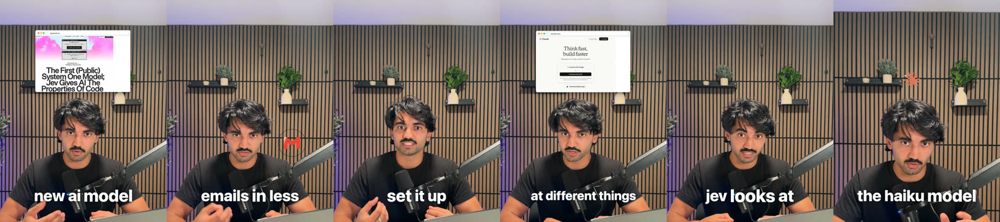

# cooked.

cooked. edits your talking-head video for you. You give it two things:

1. **Your video.** It cuts out the retakes, false starts and pauses.
2. **3 to 6 videos edited the same way.** They can come from one creator or from several. It measures
   how they are edited: cut speed, zooms, captions, cards, graphics, sound. That set of numbers is a
   **style**, and you keep it.

Then it edits your video in that style. You approve the cut, then the look, then the render. It runs in
[Claude Code](https://claude.com/claude-code) on your computer, with a window in your browser.

It also makes:

- **Shorts from a long video or podcast.** Paste the link. It finds the clips and edits each one.
- **A product video from a website.** Paste the URL. It asks what to show, records the real product
  and cuts a launch film with its own music.
- **A creator teardown.** Paste a profile. You get what makes their videos work, and a style.



<!-- TODO(owner): drop a 10-second before/after demo GIF at docs/demo.gif, then replace this comment with:  -->

Built by [NextWork](https://nextwork.ai). Free and open source (MIT). Works on Mac, Windows and Linux.

## Start here

You need [Claude Code](https://claude.com/claude-code) and a Claude account (a paid plan or an API
key). Pick one of three ways to get the editor. After that, open it from a terminal every time:

```
nextwork-editor
```

One command opens everything: your editor in the browser, at the same address every time (bookmark it),
and Claude Code behind it, listening for what you make there. Run it again when the window is already open
and it opens the window, plus a new Terminal window with Claude if none is listening. `nextwork-editor
--window-only` opens just the window. If the window ever says nobody is listening, press **Connect Claude**:
it opens Claude in a new Terminal window for you. Inside Claude Code, `/ai-editor:start` or **edit my video**
does the same. Setup adds the command; `python3 plugins/ai-editor/skills/setup/scripts/setup.py
uninstall-launcher` removes it.

**The window.** A sidebar on the left has **+ New video**, **Home**, **Your videos**, **Styles**, your
folders, the video being made right now with its progress, and **Settings**. The panel button folds the
sidebar into a row of icons. To make a video: drop in your clip (or click one you added before), pick a
style, press **Make my video**. **Make it in a new Claude chat** keeps that video's questions in their
own chat. The first time, Claude Code asks whether you trust this folder: press the down arrow to pick
**Yes, I trust this folder**, then Enter (Enter alone picks **No, exit**). It is your videos folder.

Your videos are saved in one folder, wherever you start: `~/Movies/AI Editor` on a Mac,
`~/Videos/AI Editor` on Windows and Linux. Change it in Settings (or set `AI_EDITOR_LIBRARY`).

### Way 1: open this folder in Claude Code (easiest)

**1. Install Claude Code** (skip if you have it). Open a terminal:

- **Mac:** press Cmd + Space, type `Terminal`, press Enter. Paste this and press Enter:
  ```
  curl -fsSL https://claude.ai/install.sh | bash
  ```
- **Windows:** press the Windows key, type `PowerShell`, press Enter. Paste this and press Enter:
  ```
  irm https://claude.ai/install.ps1 | iex
  ```
- **Linux:** open your terminal app and paste the Mac line.

**2. Get this folder.** Either:

- **No git:** at the top of this page click the green **Code** button, then **Download ZIP**. Unzip
  it (double-click on Mac, right-click > **Extract All** on Windows). You get a folder called
  `ai-video-editor-cooked-main`.
- **With git:** `git clone https://github.com/nextwork-projects/ai-video-editor-cooked.git`

**3. Open Claude Code in that folder.** In the terminal type `cd ` (with a space after it), drag the
folder onto the terminal window, press Enter. Then type `claude` and press Enter. The first time,
it asks you to log in.

**4. Say yes when it asks whether you trust this folder.** That lets the editor load. Then type
**edit my video**.

**5. Pick "Open the home page".** The editor opens in your browser. Follow
[Getting started](#getting-started) below.

The folder's `.claude/settings.json` turns the editor on. If Claude says the editor is not loaded,
it offers to install it: say yes, then type `/reload-plugins`.

**Fewer Allow prompts.** A Claude Code the editor opens (`nextwork-editor`, **Connect Claude** or "Open a new Claude" on
the home page) already allows the editor's own commands and nothing else: its Python and Node scripts,
`ffmpeg`, `ffprobe` and `npx remotion`. Started Claude Code yourself? Pick "Yes, and don't ask again"
the first time each is asked, or put the same rules in your library folder's `.claude/settings.local.json`
(replace `<plugin>` with the plugin folder, the path in the first command Claude runs):

```json
{"permissions": {"allow": ["Bash(python3 <plugin>/*)", "Bash(node <plugin>/*)", "Bash(ffmpeg *)", "Bash(ffprobe *)", "Bash(npx remotion *)"]}}
```

### Way 2: install the plugin, then use any folder

Inside Claude Code, type these two lines (same on every computer):

```
/plugin marketplace add nextwork-projects/ai-video-editor-cooked
/plugin install ai-editor@nextwork
```

If it asks, type `/reload-plugins`. Then say **edit my video**. `creator-teardown` installs with it.
Your edits land in your library folder (above), wherever you started Claude Code.

### Way 3: other agents (Codex, Cursor, Gemini CLI, Copilot)

In a terminal, on a computer with [Node.js](https://nodejs.org):

```
npx skills add nextwork-projects/ai-video-editor-cooked
```

`AGENTS.md` (and its copy `GEMINI.md`) tells the agent where to start. The skills share code in
`plugins/ai-editor/lib/` and the renderer in `plugins/ai-editor/remotion/`, so if your agent copies
single skill folders, clone the whole repo too.

### Want to change the editor itself?

Most people never need to. The plugin plus your own folder covers it: your styles, skills and
settings live in your folder and stay when the editor updates. See
[docs/customise.md](docs/customise.md).

If you want to change the editor's own code:

1. On GitHub, press **Fork** at the top of this page. You get your own copy.
2. In Claude Code, install the editor from your copy:
   ```
   /plugin marketplace add <your-github-name>/ai-video-editor-cooked
   /plugin install ai-editor@nextwork
   ```
3. Clone your fork and change anything you like.
4. When a new version comes out, say **update the editor** (see [Updating](#updating)).

## Getting started

The first time, the sidebar shows **Getting started** with three steps. It ticks them off as you go
and goes away once your first cut is ready.

1. **Set up.** Press **Start setup**. It checks your computer and installs what is missing: Python,
   ffmpeg, Node, the free transcription model and the renderer (about 1.5 GB, most of it the
   renderer). On GitHub's clean runners this took 25-36 s on Linux, 33-49 s on a Mac and 66-75 s on
   Windows, with the 75 MB test model in place of the 500 MB default. A home connection is slower.
   Anything that needs your password, Claude gives you to paste into your own terminal. While it
   installs, it offers two optional keys (see [Keys](#keys)).
2. **Analyse a format.** Paste 3 to 6 links to videos edited the same way, or paste a profile and
   tick its videos. Press **Analyse this format**. Claude measures them (about 3 minutes, free) and
   saves a style you can rename. The style lists the videos it came from.
3. **Make a video.** Drop in your clip. The new style is already picked. Press **Make my video**.
   No video yet? Pick **Use the sample take**.

Claude also asks a few questions once (platform, brand, captions, sound). Each is multiple choice and
the first option is fine. The answers are saved in `~/.ai-video-editor/profile.json`.

## Keys

Both are optional and free to start. They make edits better and use less of your Claude usage.
Skip either and Claude does that job instead. Add them later by saying **finish setup**.

- **ElevenLabs** transcribes every "um", false start and retake, so the cut is cleaner. Without it,
  Whisper transcribes on your computer, which tidies some of those away.
- **Gemini** (Google AI Studio) watches a format's videos and reads its fonts, colours and graphics.

Never paste a key into the chat. Claude gives you a command that saves it from your own terminal.
Keys live in `~/.config/creator-teardown/.env`.

## The editor

Each video has an editor page. It opens on the cut, then on each render.

- **Your video beside its transcript.** The transcript follows playback. Struck words were cut.
- **Suggested cuts.** Claude marks words it thinks should go. Keep them one by one, or press
  **Accept all**.
- **Change the cut yourself.** Select words to cut or restore them. **Preview** plays the cut with
  your changes. **Apply** keeps them. Undo and Discard are there too.
- **Notes.** Pause anywhere and leave a note. **Send notes** starts the next round. Approve when it
  looks right.
- **The look.** After the cut, Claude makes a sheet of frames from the styled edit. Approve, or say
  what to change. You can also move, trim, swap or delete anything by hand.
- **The render.** Claude times each place to render on your video and shows the cost first. The
  render opens on the same page: watch it, leave notes, send them or approve.
- **Teach your style.** When you approve the final video, **Teach your style from this video** turns
  your notes into short rules for that style. You see each rule and tick the ones to keep.

A correction you say in the chat ("captions too small", "fewer zooms") is saved to
`~/.ai-video-editor/taste.md` and used on every video after.

## Styles

**Styles** is one list of every style you can edit with. Each card says where it came from: built by
you, learned from your edits, or from a creator's videos. Tabs filter the list: **All**,
**Built by you**, **From creators**.

- **Card edit** is a sample style that comes with the editor: real screenshots, logos, photos and
  clips on cards behind you, a title pill on the hook, a numbered list, and a red X over a card that
  does not apply.
- **New style** opens three choices: **Analyse a format** (paste 3 to 6 videos), **Build it
  yourself** (set captions, zooms, cut, cards and sound), or **Use your own skill** (see below).
- A style's page shows it on your video, with its captions, zooms, cut, cards and sound as options.
  Changes save as you go. Make any style your default.
- **Skill styles.** A style can run a Claude Code skill instead of using settings. Its card says
  "Runs /<skill>". Making a video cuts it as usual, then runs that skill on the approved cut and puts
  its render on the editor page.
- **Archive** a style from its ⋯ menu to hide it. An **Archived** tab shows up when you have any,
  with Unarchive and Delete. **Delete** moves the style to the Trash.
- **Folders** in the sidebar filter your videos and styles. Drag a card onto a folder to file it.
  **New folder** is next to New style and at the top of Your videos.

**Your videos** lists every video, with its editor page and a ⋯ menu (Remove from this list, Move to
folder, Download, Move to Trash). **Clear working files** in Settings never deletes your clips, a cut,
a final video or your notes.

Files land in your library folder, or in a project folder you name: `videos/` (clips you dropped in),
`edits/<name>/`, `clips/<name>/`, `product/<name>/` and `creator-teardowns/<handle>/`.

## Skills

The editor is a set of Claude Code skills. Three of them help you with your own:

- **logo pack.** Gets the official, brand-colour logo of every company, app and tool named in a video,
  checks each one and shows them on one sheet. The edit uses them, and shows logos named together side
  by side.
- **skill improver.** Turns a finished video's notes into one-line rules in the style or skill that
  made it, after you say yes. It is what **Teach your style from this video** runs.
- **skill maker.** Helps you build your own editing skill. It asks a few questions, runs the task once
  without a skill, writes three test cases, drafts the skill, tests it in a fresh agent and fixes it
  with you.

For example, say **make a skill** and describe trial reels: short re-cuts of a reel you already
posted, each with a new opening line and hook. skill maker writes the skill and tests it. Then
**New style > Use your own skill** turns it into a style, so every video you make with that style gets
the trial-reel treatment. Your skills live in your own folder and stay when the editor updates.

## Updating

If you installed the plugin (Way 2), turn on auto-update once: in Claude Code type `/plugin`, open
**Marketplaces**, pick **nextwork**, then **Enable auto-update**. Claude Code then downloads new versions in
the background and loads them the next time you open it (or after `/reload-plugins`).

To update by hand, type these in Claude Code:

```
/plugin marketplace update nextwork
/plugin update ai-editor@nextwork
/reload-plugins
```

If you cloned or forked the folder, say **update the editor**. Claude makes a backup branch, pulls the
new version in, keeps your changes and runs the self-checks. If they fail, it takes you back to the
backup. It never pushes unless you ask. Settings also shows when an update is ready.

Your styles, skills and settings live in your library folder, not in the plugin, so they stay.

## What you can say

| Skill | Say | You can paste |
|---|---|---|
| `start` | "edit my video", "make my video look like @creator", "new video" | a video file path; a Google Drive, Dropbox or OneDrive share link; a YouTube or TikTok link; a creator profile |
| `setup` | "set up the editor", "finish setup", "add my Gemini key", "set up Modal" | |
| `creator-teardown` | "break down @creator", "tear down @creator" | a TikTok, YouTube or Instagram profile, or single video links |
| `cut` | "cut my video", "remove my mistakes" | a video file path |
| `style-edit` | "style it", "add captions and zooms", "render the edit", "export to Final Cut" (or Premiere, Resolve, CapCut) | |
| `overlays` | after a render: "add an animation here", "make a diagram of how this works", "this card is wrong", "swap the logo", "show the real page instead", "fewer cards" | |
| `taste` | "captions too small", "fewer zooms" | |
| `logo-pack` | "make a logo pack", "get the logos for this video", "the logos look fake" | |
| `skill-maker` | "make a skill", "create a skill", "turn this into a skill", "help me write a skill" | |
| `skill-improver` | "teach my style from this video", "turn my notes into rules", "make this feedback stick" | |
| `clips` | "clip this video", "make shorts from my podcast" | a long video, a YouTube link, a podcast episode (Apple Podcasts, RSS, YouTube) |
| `product-video` | "make a launch video for my site" | a website URL |
| `update` | "update the editor", "get the latest version", "sync my fork" | |
| `improve` | "improve the editor", "process suggestions" (for people working on this repo) | |

`motion-design` is a reference the other skills read; you do not call it yourself.

A Spotify episode is usually locked: paste the same episode from Apple Podcasts, YouTube or its RSS
feed. An iCloud link opens a web page, not the file: download the video first and give its path.

## What it costs

The editor is free. These are what you may pay for. Numbers marked *estimate* are worked out from
published prices, not measured on a bill.

| Part | Cost | Notes |
|---|---|---|
| Claude | Your Claude plan's usage | Not yet measured per video. The keys below lower it. |
| Gemini key (reads a creator's look) | Free | Google AI Studio's free tier, no card. On the paid tier a 7-video teardown measured about $0.02. |
| ElevenLabs key (keeps every "um") | Free for a few hours a month | Optional. Without it, Whisper transcribes on your computer for free. |
| Render on your laptop | Free | Often the fastest for a short video. The styled 44.9-second cut of the sample take (1,346 frames) rendered in 35-84 s on a laptop also running other work; `edit.py estimate` was within 25% of the render in 3 of 4 tries. Claude prints the numbers for your video before you pick. |
| Render on Modal | $0.03 for the 44.9-second sample cut (2.7 min on 3 machines, at Modal's rates). $0.18-0.19 for the whole 3.4-minute sample take rendered uncut (6,167 frames, measured on the bill). About $0.06 for 60 s and $0.54 for 10 min (*estimate*). | The Starter plan includes $30 of free credit a month. The uncut 3.4-minute take took 3.1 min on Modal (4.3 min when the laptop was overloaded during the join) and 6.8 min on a busy laptop. The first render also builds the render machine once (about 2 min). |
| Render on GitHub Actions | Free | Counts against 2,000 free minutes a month on private repos. The 44-second sample cut took about 7 minutes. |
| Render on AWS Lambda | A few cents to a few dollars (*estimate*) | Your own AWS account, card needed. Not measured yet. Claude quotes each render first. |

### Cloud renders

- **Modal** (modal.com): your video is split into pieces that render at once on rented machines,
  then joined on your laptop. Say **set up Modal**; Claude walks you through the free account and
  logs this computer in.
- **GitHub Actions**: free, no card. Claude packs the renderer and your footage into a **private**
  repo in your account (it asks first), renders on up to 20 machines and downloads the result. Say
  **set up GitHub rendering**.
- **AWS Lambda**: many machines at once on your own AWS account. One-time setup of about 20 minutes.
  Say **set up Lambda rendering**.

## Your data

- Everything runs on your computer unless you pick a cloud render. After a cloud render your footage
  is deleted from the service, unless you said to keep it.
- A product video of a logged-in site uses its own browser profile, never your main one. You log in
  by hand, and Claude asks to delete the login when the video is done.
- Names, emails and account details on screen are blurred by default, your own included.
- It never clicks anything that creates, deletes, pays, publishes or invites unless you said yes
  for that video.
- A suggestion you share to help everyone has your names, handles and web addresses removed first.

## Troubleshooting

| Problem | What to do |
|---|---|
| Something is missing or broken | Say **run the editor doctor**. Every line reads `ok`, or `FIX` with the exact command for your computer. |
| Doctor says something moved off the pinned versions | Say **repair the editor setup**. Claude runs `setup.py repair` from wherever the plugin is installed, and it puts the exact pinned set back. From a cloned folder (Way 1) you can run it yourself: `python3 plugins/ai-editor/skills/setup/scripts/setup.py repair` (`py` instead of `python3` on Windows). |
| You skipped a key or step | Say **finish setup**. Only the skipped steps run. |
| Where do Claude's questions show up? | In the editor's window or review page when one is open in front of you; answer there. Otherwise in the terminal. Permission prompts (Allow or Deny for a command) always show in the terminal. |
| Claude does not know "edit my video" | The editor is not loaded. Type `/reload-plugins`, or install it with Way 2. |
| `python3` not found | Mac: `brew install python`. Windows: `winget install -e --id Python.Python.3.12`, then open a new terminal. Linux: `sudo apt install -y python3 python3-venv`. |
| Node is too old on Debian or Ubuntu | Doctor prints the fix: it adds NodeSource's signed package source, then installs Node. |
| Chrome or Chromium installed as a Flatpak | Only logged-in product videos need your Chrome, and a Flatpak one cannot be used. Install Google Chrome or your distro's `chromium` package; doctor says which it found. |
| A tool installed on Windows is still "not found" | Close and reopen Claude Code: a `winget` install only shows up in a new terminal. |
| `yt-dlp returned nothing` | The site changed. Doctor shows how to update yt-dlp, or paste single video links. |
| An Instagram profile fails | Instagram has no free way to list a profile. Paste 10 or more reel links. |
| `Gemini rejected the key` | Make a new key at the link it prints. The teardown carries on without it meanwhile. |
| A Drive or Dropbox link fails | Share it as **Anyone with the link**, and link the video file, not the folder. |
| `the Modal render failed` | Claude offers the laptop render instead. |
| You logged into a site for a product video and want that login gone | Say **log me out of <site>**. Claude runs `login.mjs logout <site>`. From a cloned folder (Way 1): `node plugins/ai-editor/skills/product-video/scripts/login.mjs logout <site>`. |
| Where are my keys? | `~/.config/creator-teardown/.env`, shared by both plugins. With `AI_EDITOR_HOME` set, `$AI_EDITOR_HOME/.env` instead, and the shared file is never read. |

Without Claude, from a cloned folder (Way 1), one command does the whole install and is safe to re-run:

```
python3 plugins/ai-editor/skills/setup/scripts/setup.py bootstrap
```

Every install gets the same versions: Python packages from a hashed lock file
(`plugins/ai-editor/requirements/requirements.lock`), Node packages from `package-lock.json`, and
each model checked against its sha256.

## License

This repo is MIT. See [LICENSE](LICENSE) and [NOTICE](NOTICE).

The tools it runs have their own licences:

| Tool | Licence | What it means for you |
|---|---|---|
| [Remotion](https://www.remotion.dev/license) (the renderer) | Remotion License | Free for individuals and for companies of up to 3 people. Bigger companies need a Remotion company licence. |
| [GSAP](https://gsap.com/community/standard-license/) (animation in the renderer, and the `gsap-skills` plugin) | GSAP Standard License | Free, commercial use included, every plugin too. Not an OSI open-source licence. It bans using GSAP in a no-code visual animation builder that competes with Webflow's. |
| [HyperFrames](https://github.com/heygen-com/hyperframes) (the `hyperframes` plugin, and code ported from it) | Apache-2.0 | Free. Ported code keeps HeyGen's copyright, listed in [NOTICE](NOTICE). |

Assets fetched while editing: brand logos from [Simple Icons](https://simpleicons.org) (CC0), icons
from [Lucide](https://lucide.dev) ([ISC licence](https://lucide.dev/license)).

## Contributing

- The rules every video follows, for every user:
  [plugins/ai-editor/PRINCIPLES.md](plugins/ai-editor/PRINCIPLES.md).
- Open this folder in Claude Code and say **improve the editor**: the `improve` skill turns the
  corrections users marked "would help everyone" into rules, checks and tests here.
- What is next: [docs/BACKLOG.md](docs/BACKLOG.md). What changed: [CHANGELOG.md](CHANGELOG.md).
- In this folder the editor loads from your working copy. To turn it off while you work, set
  `"ai-editor@nextwork": false` under `enabledPlugins` in `.claude/settings.local.json`.
- Run the checks before a pull request:
  ```
  python3 tests/check_plugins.py
  claude plugin validate --strict .
  python3 tests/smoke.py
  ```
  plus each script's `demo` (the list is in `.github/workflows/check.yml`). The model evals cost
  money; `tests/run_evals.sh --runs 1 --case <case>` runs one.
